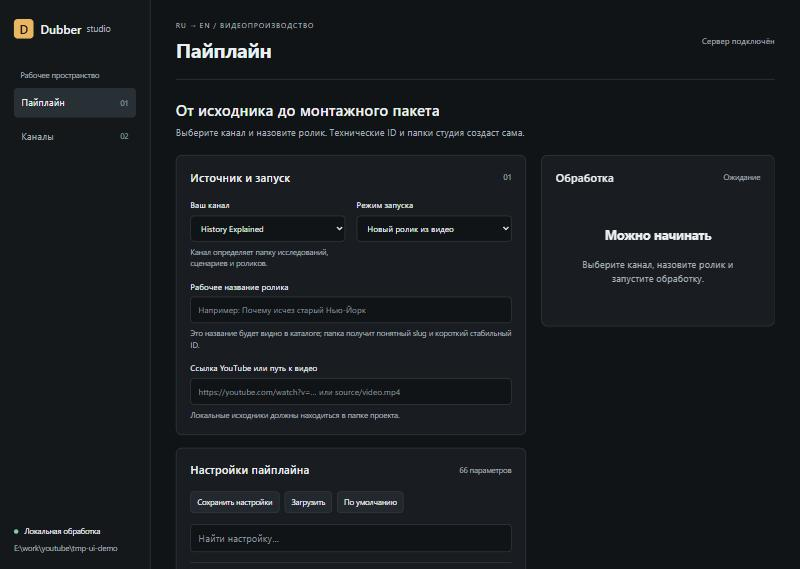
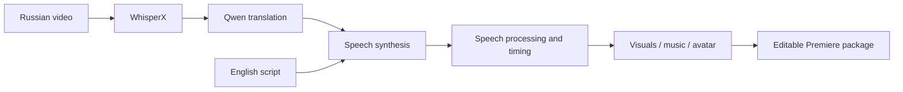
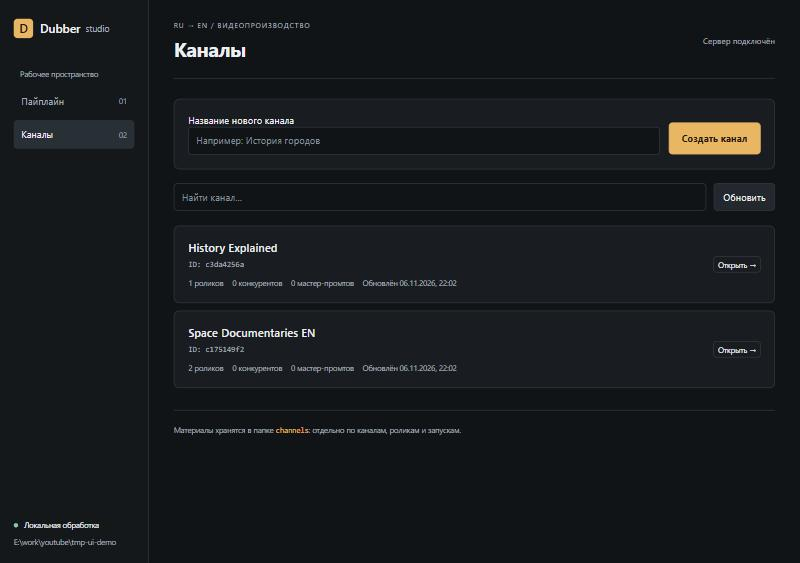
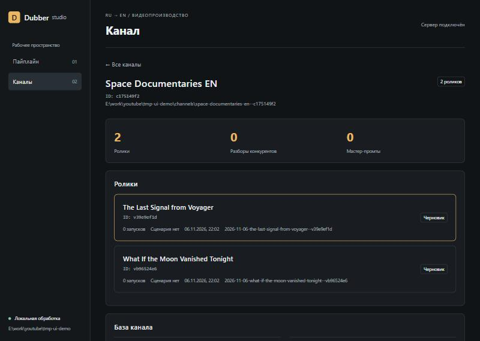
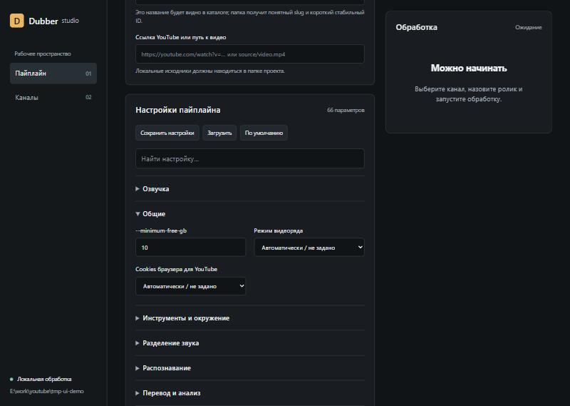

# RU → EN Dubber

**Turn a Russian video into an English dub you can still edit.**

A local Windows pipeline for transcription, translation, voice synthesis, timing,
and an editable Adobe Premiere package. Start with one video, a YouTube URL, or an
English narration script. Keep the source, inspect each stage, and refine the edit.

**Beta · Windows · Python 3.11+ · MIT**



## Why use it?

- **Editable delivery.** Export FCP 7 XML, separate voice/background tracks, media,
  captions, and reports rather than a single flattened video.
- **Local speech and translation.** Run WhisperX, Qwen through llama.cpp, and
  Chatterbox in separate environments. Optional media searches use external services.
- **Inspectable runs.** A portable `manifest.json` records stage state and relative
  artifact paths. A loopback Web UI shows channels, videos, runs, and progress.
- **Flexible input.** Dub an existing video or build narration from an English
  script, including an audio-only route.
- **Optional finishing.** Speech mastering, licensed visual replacements, music,
  and a MuseTalk avatar are separate, configurable stages.



## Try the interface first

From a checkout, in PowerShell:

```powershell
py -3.12 -m venv .venv
.\.venv\Scripts\python.exe -m pip install -e .
.\.venv\Scripts\python.exe -m ru_en_dubber.web.server --open
```

Open [the local interface](http://127.0.0.1:8765). This starts the catalog and UI;
processing media requires the [runtime setup](docs/installation.md). The current
Web UI contains Russian labels. The CLI help and this documentation are in English.

> The screenshots below use a synthetic demo workspace; no production channels or
> media are shown.

| Channels catalog | Channel detail |
| --- | --- |
|  |  |

Pipeline settings are grouped and searchable (66 parameters):



After runtime setup, use `scripts/START_WEB_UI.cmd` or inspect the CLI:

```powershell
.\.venv\Scripts\python.exe -m ru_en_dubber.cli --help
```

Create a channel and video in the Web UI before using their run directory with the
low-level CLI. See [usage and outputs](docs/usage.md) for video, script, and recovery examples.

## What to expect

This is a working beta for technical users who can configure local models and GPU
environments. It is **not a one-click installer**. Dependencies and model weights
are installed separately; not every stage has a CPU fallback.

Automated checks cover contracts, path/download safety, stage composition, UI
services, export structure, and selected FFmpeg processing. They do **not** establish
CUDA compatibility, live-provider availability, dubbing quality, or successful
imports into Premiere. Review the [release status and manual checks](docs/release.md).

Ad removal defaults to `remove` with a confidence threshold of `0.85`; review the
generated ranges before using the edit. Choose `--ad-removal mark` for review or
`--ad-removal off` to disable it. Source files are preserved.

## Documentation

| Guide | Contents |
| --- | --- |
| [Installation](docs/installation.md) | Separate Python/CUDA environments, models, keys |
| [Usage](docs/usage.md) | Video/script input, visual modes, output layout, recovery |
| [Architecture](docs/architecture.md) | Stage contracts, durable workspace, security boundaries |
| [Speech processing](docs/P6-speech-postprocess.md) | Loudness, peak limits, bypass, raw audio preservation |
| [Contributing](.github/CONTRIBUTING.md) | Development checks and useful bug reports |
| [Release status](docs/release.md) | Beta limits, verification, publishing a clean history |

## Privacy and licensing

Channels, scripts, voice references, avatars, credentials, models, and generated
media stay in ignored local directories. This source distribution contains no
production videos or voice samples. Run the public-content audit before publishing:

```powershell
python scripts/audit_public_release.py --history
```

It checks reachable Git content; pattern scanning is
a safeguard, not proof that arbitrary personal information is absent.

The project code is [MIT licensed](LICENSE). Model weights, external software,
source videos, music, stock assets, and voice rights have their own terms; see
[third-party notices](docs/third-party-notices.md).
